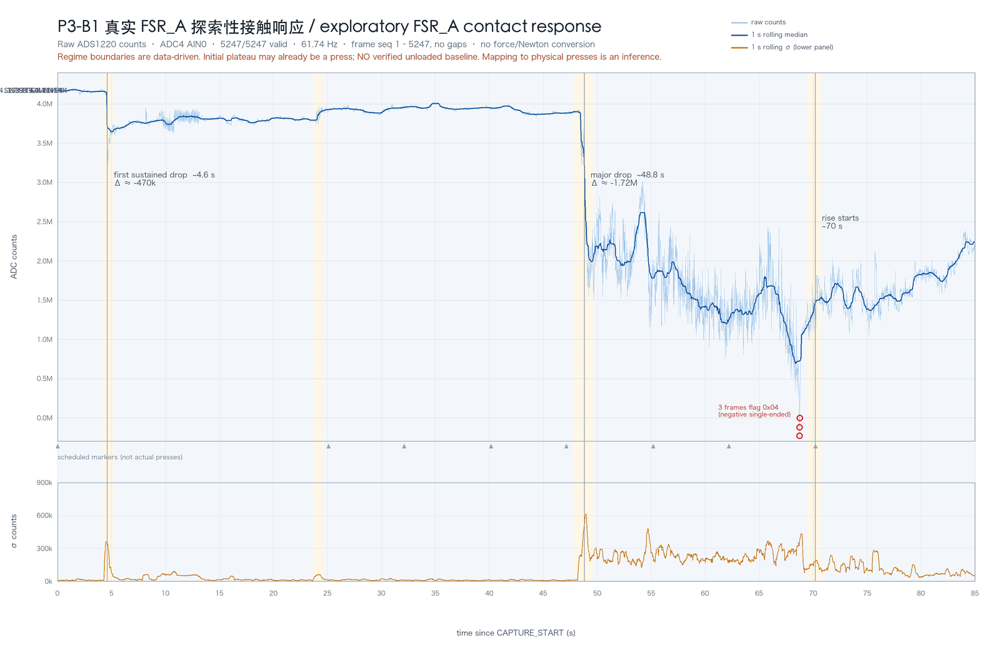

# P3-B1｜真实 FSR_A 手指按压数据接管分析（2026-11-15）

状态：**探索性真实采集分析完成**。本文件只分析已有真实数据，不包含任何新的舵机动作或补测。
证据类型：`VERIFIED_REAL` 仅指“ADC4 AIN0 真实帧有效且接触变化可测”；按压位置、力度、
时间标注、牛顿/摩擦力/滑移/杯重换算均为 `NOT_TESTED` 或 `NOT_SUPPORTED`。

## 1. 数据来源与现场事实

| 项 | 值 | 依据 |
|---|---|---|
| 采集时间 | 2026-11-15T15:12:55Z 起，约 85.0 s | `CAPTURE_START` / 最后 SAMPLE |
| 固件 | `tactile-fsr2-0.3.0`，`FSR_ONLY`，`FSR_ONLY_1CH` | 真实 HELLO |
| 通道 | 唯一 FSR_A：ADC4，AIN0，MUX 8，单端 AIN0–AVSS | 真实 HELLO / `channel_config` |
| 参考 | `AVDD_AVSS`，增益 1，PGA bypass | 真实 HELLO |
| 串口 | CP2102 USB-UART，921600 8N1（端口名不写入公开文档） | capture summary |
| 原始帧 | 5247 个 SAMPLE，帧序 1–5247，0 缺帧，0 重复/乱序 | `capture_timestamped.jsonl` |
| 有效帧率 | 实测 61.74 Hz；MCU 帧周期均值 16.198 ms，中位 16.001 ms，最大 22.409 ms | 帧字段 + 主机时间 |
| 有效性 | 5247/5247 `valid=true`（100%） | `valid[]` |
| ADC4 状态 | 5247/5247 `OK`，0 次非 OK | `adc_status` |
| ADC1–3 | 全程 `NO_RESPONSE`（本构建只装 ADC4，符合预期） | HELLO/STATUS/SAMPLE |
| 饱和 | 0 帧 `SAT_HIGH`/`SAT_LOW`；0 帧 `NO_DATA` | `channel_flags` |
| 异常帧 | 仅 3 帧 flag `0x04`（负单端），t=68.734/68.750/68.766 s，值 −124161/−230142/−1592 | `channel_flags` |
| 传输异常 | 采集开始后 1 条 875 B 非 JSON RX（大量 NUL/替换字符），已丢弃，未进入样本 | `capture_timestamped.jsonl` |

原始文件 SHA-256（本地私有，`evidence/` 不提交）：

- `capture_timestamped.jsonl`：`fee9cb2aacd348497193a43f2b881cc8f0d4f02bed6bcdc4aedb4ff50be2eb96`
- `capture_wire_raw.jsonl`：`359eb0795112595d7603c47e5e3aca1989ad90750beb0f5dadc3d13147c4a498`
- `capture_samples.csv`：`f85940fe8e999a3526efbbb05cd1f6876a95773e84a8c3160447599c75cee944`

> 采集脚本按“三段式按压”预写了 25/32/40/47/55/62/70 s 的 marker，但操作者实际没有按该计划
> 执行。**这些 marker 不是按压/释放的真实标注**，不能用于窗口统计。旧的
> `capture_analysis.json` 以这些计划窗口切分，已保留为 `capture_analysis_schedule_assumed.json`
> 供审计；本文件使用从信号本身推导的分段（`capture_analysis_v2.json`）。

## 2. 实测信号

### 2.1 从数据本身得到的分段

分段边界来自可见的持续电平变化，不是操作者逐秒标注。S=相对稳定段，T=过渡段。

| 段 | 时间 (s) | n | 中位数 (counts) | 标准差 | 最小–最大 | 段内漂移 |
|---|---|---:|---:|---:|---:|---:|
| S0 初始稳定 | 0.0–4.2 | 257 | 4,163,273 | 15,925 | 4,104,667–4,202,314 | −3.2k counts/s |
| T1 首次持续变化 | 4.2–5.2 | 62 | 3,687,712 | 305,300 | 3,224,742–4,180,114 | — |
| S1 低位平台 | 5.2–23.7 | 1142 | 3,794,418 | 50,370 | 3,603,761–3,951,393 | +3.2k counts/s |
| T2 小幅上台阶 | 23.7–24.6 | 56 | 3,859,700 | 66,315 | 3,727,436–3,966,788 | — |
| S2 高位平台 | 24.6–47.8 | 1432 | 3,934,764 | 36,740 | 3,841,498–4,034,664 | −1.8k counts/s |
| T3 大幅变化/不稳定 | 47.8–49.6 | 111 | 3,439,939 | 858,024 | 1,565,516–3,930,043 | — |
| S3 低位不稳定 | 49.6–69.5 | 1229 | 1,604,983 | 500,543 | −230,142–3,004,612 | −61.6k counts/s |
| T4 方差下降 | 69.5–70.8 | 80 | 1,453,665 | 218,272 | 990,950–1,816,778 | — |
| S4 末段回升 | 70.8–85.0 | 877 | 1,679,409 | 261,111 | 1,053,127–2,385,815 | +44.6k counts/s |

### 2.2 主要变化量

| 变化 | 时刻（约） | 变化前中位 | 变化后中位 | Δ counts |
|---|---|---:|---:|---:|
| 首次持续下降 | 4.6 s | 4,159,274 | 3,688,947 | **−470,328** |
| 小幅上升 | 23.9 s | 3,802,499 | 3,927,790 | **+125,291** |
| 大幅下降 | 48.8 s | 3,884,070 | 2,161,433 | **−1,722,637** |
| 方差下降/回升起点 | 70.0 s | 1,064,950 | 1,468,126 | **+403,176** |

- 初始稳定段（S0）峰峰值 97,647 counts，MAD σ ≈ 16,266 counts；后续持续变化为 0.13M–1.72M counts，
  是初始噪声的约 8–100 倍，**接触/位置变化不是噪声**。
- S3 内出现多次 0.7M–1.1M counts 的单帧跳变，且方差显著高于 S0；这更像手/夹具在调整位置时的
  间歇接触或机械扰动，而不是正常 ADC 基线噪声。
- 末段 S4 从约 1.1M 缓慢回升到约 2.3M，但 capture 结束时仍远低于初始 4.16M，**没有观察到完整
  回到初始基线**。这是慢释放/蠕变/仍受载中的一种，当前无法区分。

### 2.3 与操作者叙述的对应（推测）

操作者描述：**先在一个位置按压，随后调整位置，在另一个位置以中等力度施压**；没有按三段式计划。
采集开始时操作者很可能**已经在第一处按压**，所以 0–4.2 s 的 4.16M 不能当作已验证的空载基线。
最自然的对应是：

1. **0–4.2 s**：第一处按压已在进行，counts 稳定在 4.16M。
2. **约 4.6 s**：部分释放/放松，counts 下降约 0.47M，随后在 3.79M 附近缓慢蠕变。
3. **约 23.9 s**：重新加压或调整，counts 上升约 0.13M，之后在 3.93M 附近稳定约 23 s。
4. **约 48.8 s**：释放并移动到第二处，出现最大下降（−1.72M）和约 20 s 的高方差段。
5. **约 70 s 起**：在第二处以中等力度施压，counts 以约 +44.6k counts/s 回升，capture 结束时约 2.3M，
   仍在上升，尚未回到第一处的 4.16M。

这个读法最符合操作者叙述，也与配置的 `VOLTAGE_RISES_WITH_FORCE` 一致。另一种读法（0–4.2 s 是空载，
两个下降都是按压）会得到相反极性；仅凭本次 capture 不能排除它，但它不如“采集开始时已在按压”符合
操作者叙述。上述 1–5 仍是**推测**，不是逐秒标注。可以确定的是：真实接触/位置变化在 FSR_A 上产生了
清晰、可持续、远超噪声的电平变化。

### 2.4 极性判断（重要）

配置写的是 `response_polarity = VOLTAGE_RISES_WITH_FORCE`（力增大 → counts 上升）。原始 capture
**起点没有经过验证的空载基线**，但事后两次短采集给出了关键对照：

- 15:34Z：中位 614k counts，值在 0–1.57M 间，19 帧 flag `0x04` → 释放过程中的余压/部分接触。
- 15:37Z：中位 1.7k counts，值约 −12k…+16k，230/494 帧 flag `0x04` → 已释放，近零基线；
  负帧集中在 0 附近（±15k counts ≈ ±6mV），是零点噪声，不是通信故障。

这与“10 kΩ 下拉、FSR 未受压时 AIN0 ≈ 0 V；受压后电阻下降、节点电压上升”的接线一致：
**未载 ≈ 0，第一处按压 ≈ 4.16M**。因此原始 capture 最合理的读法是：

- **0–4.2 s**：第一处按压已在进行（4.16M）；
- **4.6 s / 48.8 s 的下降**：部分释放 / 释放并移动；
- **70 s 后的上升**：第二处按压（中等力度，约 2.2M）。

这支持文档的 `VOLTAGE_RISES_WITH_FORCE`。反过来的读法（0–4.2 s 是空载、两个下降是按压）要求
“空载 ≈ 4.16M、释放后 ≈ 0”，与 15:37Z 的事后空载基线矛盾，因此**基本可以排除**。

仍保留的限制：原始 capture 不是“同一 trial 内空载→夹持→释放”的连续记录；15:37Z 基线是事后单独
采集的。空杯 trial 仍必须在夹持前采一次连续的空载基线，才能把极性标为单 trial 已验证。

### 2.5 事后空载基线复测（2026-11-15T15:34Z / 15:37Z）

| 时间 | 帧数 | 值域 | flag 0x04 | 判断 |
|---|---:|---:|---:|---|
| 15:34:48Z | 485 | −207,687 … 1,571,726（中位 614,058） | 19 | 释放过程中的余压/部分接触 |
| 15:37:20Z | 494 | −11,714 … 15,930（中位 1,726） | **230（46.6%）** | 已释放；近零空载基线，负帧为零点噪声 |

15:37Z 的 `raw_adc` 与 `channels` 一致，ADC4 仍 `OK`，帧有效；近零读数与 10 kΩ 下拉、FSR 未受压
一致。**结论：FSR_A 很可能工作正常，当前是有效的近零空载基线，不是接线损坏。** 230 个负帧是
零点附近的噪声，固件按 `value < 0` 打 `0x04` 标志；分析时应把它们当作基线噪声/无效样本处理，
不能把它们解释为负力。空杯 trial 的 FSR 曲线应以原始 counts 为主，并在夹持前重新采空载基线。

## 3. 能与不能下的结论

### 3.1 可以确认（VERIFIED_REAL）

- ADC4 AIN0 / FSR_A 在真实固件下持续输出有效帧，61.74 Hz，无缺帧，无饱和，ADC4 全程 `OK`。
- 真实接触/位置变化产生了清晰的、远超基线噪声的 ADC counts 变化；**FSR 初步响应验证成功**，
  不需要重做手指三段式按压。
- 采集起点不是已验证空载；0–4.2 s 很可能是第一处按压，不能当作空载基线。
- 变化不是单一尖峰：存在持续数秒到数十秒的电平段，可用于后续空杯接触/释放观察。
- 采集期间存在一次 3 帧负单端异常和一次开始时的非 JSON 串口噪声；两者都被记录，不影响总体结论。

### 3.2 不能确认（NOT_TESTED / NOT_SUPPORTED）

- 不能把 counts 换算成牛顿、压力、摩擦力、滑移量或杯重；没有独立标定。
- 不能确认按压位置、力度、时间与数据段的精确对应；操作者未逐秒标注，marker 只是计划时间。
- 原始 capture 不是同一 trial 的连续空载→夹持→释放；事后 15:37Z 空载基线支持
  “上升=力增大”，但单 trial 极性仍 **NOT_TESTED**。
- 不能确认完整释放时间常数；capture 结束时信号仍远离初始基线。
- 不能用本次数据确定空杯抓取的成功 PWM 或接触阈值。
- 15:37Z 的近零基线是有效的空载读数（未载≈0），不是接线损坏；但它是事后单独采集的，
  原始 capture 本身没有连续的空载→夹持→释放段。

## 4. 对下一步空杯实验的要求

1. 每个 trial 开始前记录**明确的空载基线**（爪张开、杯未接触，至少数秒），不要跨 trial 复用基线。
2. 记录**已知的 PWM 时序**（1500 → 逐步接近 → 首次接触 → 保持 → 释放）并与 FSR 时间轴对齐。
3. 保持 `AUTO_REAL_ENABLED=False`；不根据 FSR 自动控制舵机。
4. Dashboard 只用原始 counts 曲线；在极性未确认前，不把接触评分当作真实接触判据。
5. 至少做一次“空载 → 轻夹 → 释放”的完整周期，观察释放是否回到基线；若仍不回归，记录为慢恢复/蠕变，
   不强行解释为滑移或杯重。

## 5. 当前判定

| 项目 | 状态 |
|---|---|
| ADC4 AIN0 真实采集链路 | **VERIFIED_REAL** |
| FSR_A 对真实接触/位置变化的响应 | **VERIFIED_REAL（探索性）** |
| 是否需要重做手指三段式 | **不需要**（现有真实数据已足够判断初步响应） |
| 按压位置/力度/时间标注 | **NOT_TESTED** |
| counts → 牛顿/摩擦/滑移/杯重 | **NOT_SUPPORTED** |
| FSR 极性 | **SUPPORTED（未载≈0、按压≈4.16M；事后基线，非同一 trial）** |
| 当前 FSR_A 空载基线 | **VALID_UNLOADED（≈0；230/494 负帧为零点噪声；ADC4 OK）** |
| 空杯 MANUAL 抓取 | **NOT_TESTED（已授权 1300–1500 μs；唯一阻塞：S3 端口未枚举）** |
