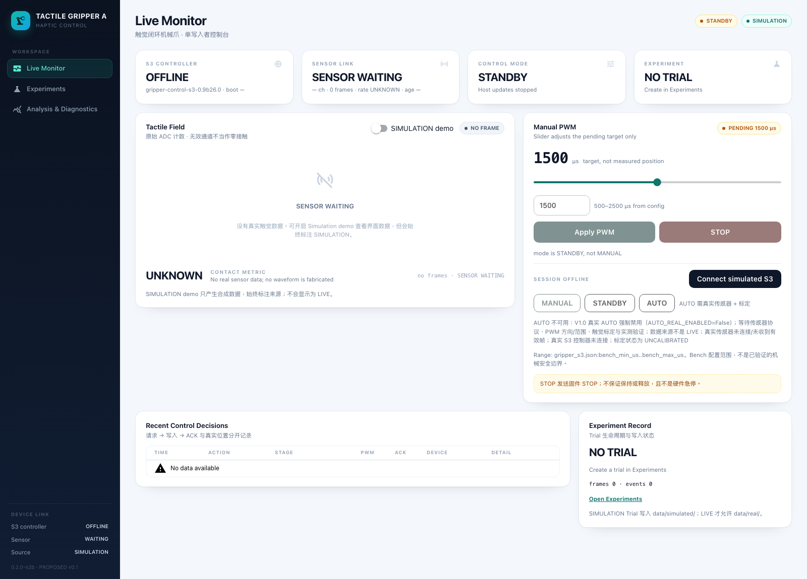
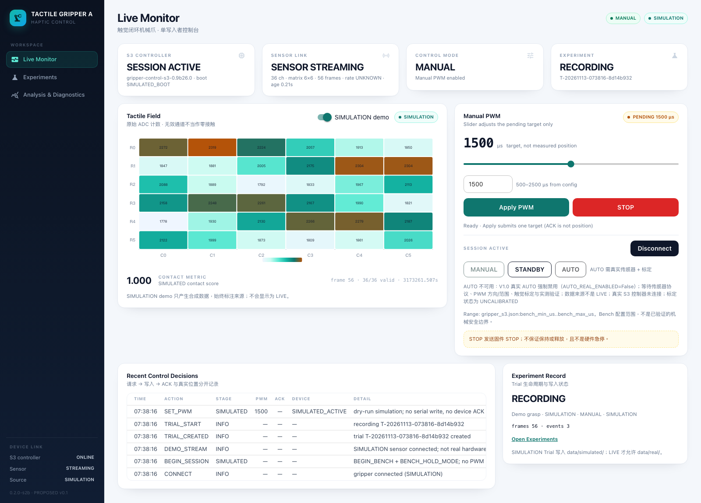

# 触觉闭环机械爪 软件 V1.0 交付报告

- 日期：2026-11-13
- 工作目录：`/home/example/Developer/research/tactile-gripper-a-sw`
- 分支：`feat/software-v1`
- V1.0 代码提交：**`631f1ca feat(v1): complete offline dashboard, sensor and analysis features`**
- 前置提交：`24a4254`（S2-B）、`acd38f6`（S2-A）
- 软件状态：**OFFLINE_FEATURE_COMPLETE**
- 真实硬件边界：未打开真实串口、未发送 PWM、未连接真实传感器、未烧录固件。截图与演示数据均为 `SIMULATION`。

## 1. Git 与工作区

| 项目 | 状态 |
|---|---|
| 软件 Worktree | `feat/software-v1`，V1 代码提交 `631f1ca` |
| `main` | `dec50b1`，未修改 |
| 硬件 Worktree | `feat/hardware-acquisition`，仍为 `dec50b1`；检测到硬件组并发创建的未跟踪 `firmware/sensor/`、`docs/hardware/` 等文件，本轮**未读取/修改/提交** |
| 远程 | 未 push |
| 合并 | 未合并 main |

V1 还包含独立的文档/截图提交（README、docs、screenshots）；代码提交不包含实验数据。

## 2. 完成的功能

### 2.1 Dashboard V1.0

- **Live Monitor**：S3/传感器在线状态、MANUAL/STANDBY/AUTO/FAULT、PWM 目标与 `STAGE/ACK/DEVICE`、Connect/Begin/Apply/STOP、动态矩阵热图/柱图、通道有效性、采样率、数据新鲜度、重连次数、Trial 状态、FAIL/写错误横幅。
- **Experiments**：Trial 名称、Object、Cup type、Material、Water/mass(g)、Operator、Grasp target、Video path；Start / Stop & complete / Abort；事件标记；视频路径更新；运行中参数快照；Trial History；CSV。
- **Analysis**：Source/Status/Search 过滤；单 Trial 回放；帧检查；动态通道趋势；PWM Timeline；控制事件/ACK/命令 ID；异常与故障；数据完整性摘要；截断尾行提示；视频/操作员/schema/git；多 Trial 对比表；CSV 导出；只读（无 Apply/STOP）。

### 2.2 传感器串口接收框架

- `SerialSensorTransport`：显式连接、可配置端口/波特率/校验/停止位、DTR/RTS 先置 false、boot wait、有界行读取、超长行丢弃统计、无 write 方法。
- `SensorAdapter`：HELLO/SAMPLE/STATUS/ERROR 解析、主机接收时间、通道有效性、boot_id/帧序号、丢帧/重启/时间戳异常、重连退避与统计。
- 配置：[config/sensor_serial.json](../config/sensor_serial.json)，默认 `port=null`。
- 与上层数据隔离：transport / parser / core 分层；协议确认后可替换 transport。

### 2.3 AUTO 软件框架（真实 AUTO 仍禁用）

- `RuleBasedAutoPolicy`：信号过期、有效通道不足、contact metric 缺失、接触阈值、速率、步数/累计限制、AUTO gate。
- `SimulatedAutoSession`：只在 SIMULATION gate 下运行，供离线场景测试。
- `AUTO_REAL_ENABLED=False` 硬开关；`ApplicationCore.set_mode(AUTO)` 在发送任何命令前失败。
- 未从 ADC 值推断摩擦力、重量或滑移；没有真实标定不启用自动策略。

### 2.4 Trial 可靠性

- schema v3：`video_path`、`operator`、`tags`、git commit、配置快照、完整性计数。
- 唯一 Trial ID；创建时检查目录冲突。
- `recording.json` PID/host/heartbeat；活动 Trial 不会被误判中断；第二写入者被拒绝。
- `COMPLETED / ABORTED / INTERRUPTED / ERROR` 明确区分。
- JSONL 不完整尾行忽略并报告，不误当完整数据。
- 事件/异常 deque 溢出计数。
- 协调 shutdown：Trial → sensor → gripper → 锁释放。
- v1/v2 数据仍可读取；v3 只增加字段。

### 2.5 演示与文档

- [README](../README.md) 更新 V1 快速启动。
- [运行手册](SOFTWARE_RUNBOOK.md)
- [数据格式](DATA_FORMAT_V1.md)
- [硬件联调前置条件/接口清单](HARDWARE_INTEGRATION_CHECKLIST.md)
- [协议协作说明](PROTOCOL_COLLABORATION.md)
- 无界面演示脚本：[scripts/run_simulation_demo.py](../scripts/run_simulation_demo.py)

## 3. 主要修复的缺陷

1. FAULT 下 STOP 的 ACK 被误显示为正常结束；现在 Adapter/Core 保留 FAULT，DISARM 才清除。
2. dry-run `BENCH_HOLD` 状态误导；现在标 `SIMULATED_ACTIVE`。
3. Connect 与建立会话混在一次点击；已分离。
4. 传感器断线无重连；新增退避重连，S3 控制侧仍不自动重连/恢复运动。
5. Trial 中断无恢复；新增锁/心跳/`INTERRUPTED`。
6. 写失败会传播或静默；新增 `TrialWriteError`、`ERROR`、UI 提示。
7. 旧 Trial 元数据缺 Git/schema/视频/完整性；已补齐并兼容。
8. 无界事件缓存无统计；增加 overflow 计数。
9. JSONL 崩溃尾行；现在忽略并在完整性摘要中报告。
10. 多个进程/重复 recorder 可同时写 Trial；新增锁检查和唯一 ID。
11. Dashboard 缺模式切换/故障恢复/完整性/PWM 关联；已补齐。

## 4. 可复现演示

```bash
cd /home/example/Developer/research/tactile-gripper-a-sw
UV_CACHE_DIR=/tmp/uv-cache uv sync --locked

# Dashboard：默认 OFFLINE / SIMULATION，不打开硬件
PYTHONPATH=src .venv/bin/python -m tactile_gripper.ui --no-browser --port 8080

# Dashboard：明确 SIMULATION demo
PYTHONPATH=src .venv/bin/python -m tactile_gripper.ui --no-browser --demo --port 8080
```

无界面完整流程：

```bash
PYTHONPATH=src .venv/bin/python scripts/run_simulation_demo.py --ticks 30 --interval 0.05
```

验证结果（本轮实际执行）：Trial 创建/记录/停止成功，输出 8 帧，`frames.csv`/`frames.jsonl`/`events.jsonl`/`metadata.json` 均生成，状态 `COMPLETED`，只写 `data/simulated/trials/`。

## 5. Dashboard 截图

离线启动（S3 OFFLINE / SENSOR WAITING，控制按钮禁用）：



SIMULATION Live Monitor（合成数据，明确标注）：



Experiments（条件、视频路径、Start/Stop/Abort、历史）：


Analysis（过滤、完整性、PWM Timeline、中断提示、视频/操作员/schema）：


## 6. 测试与稳定性

```bash
PYTHONPATH=src .venv/bin/python -m unittest discover -s tests -v
```

```text
Ran 247 tests in 8.7s
OK (skipped=1)
```

- 基线 219 项全部通过；新增 28 项。
- 唯一 skip：沙箱无 PTY（`out of pty devices`），既有测试已注明。
- 新增覆盖：SerialSensorTransport（fake pyserial）、HELLO/SAMPLE、超长行、重连、AUTO 正常/过期/无效通道/接触/限速/上限、Trial schema v3/视频/唯一 ID/锁冲突/截断尾行、shutdown、有界队列、Analysis 过滤/对比。
- 6.8 秒离线连续运行：300 ticks、33 帧、事件队列 ≤ 上限、`event_overflow=0`、tracemalloc current ≈56 KB / peak ≈65 KB（本机观测，非长期内存结论）。
- 测试不依赖真实 ESP32/传感器。

## 7. 数据记录与回放验证

- 正常 Trial：创建 → Start → 记录帧/控制事件 → Stop → `COMPLETED`；CSV/JSONL 可读取。
- 中断 Trial：锁中 PID 失效 → 恢复为 `INTERRUPTED`，保留已有帧/事件，追加 `TRIAL_INTERRUPTED`，不标 COMPLETED。
- 截断尾行：忽略不完整最后一行，`truncated_tail=True`、`read_errors` 报告，之前数据保留。
- 控制关联：`CONTROL_EVENT` 保存 command_id/stage/serial_write_ok/device_ack/actual_pwm_us(null)/firmware_state/response。
- Analysis 可读取历史、回放、对比、导出；无 Apply/STOP 入口，不触发硬件。
- 视频只做路径关联；本机文件存在性在 UI 标注，不做流媒体/编辑。

## 8. 真实硬件待验证（NOT_TESTED / BLOCKED_BY_HARDWARE）

- 真实传感器串口协议、HELLO/SAMPLE 实际字段、扫描率、映射、时序。
- 真实 S3 `BEGIN_BENCH`、`BENCH_HOLD`、STOP/DISARM 的实机时序、FAULT 恢复、停止延迟。
- 真实 PWM 方向/范围、机械位置/开度、保持/释放/掉落。
- 触觉标定、接触指标、阈值与 AUTO 自动控制。
- 真实视频采集与文件关联、真实 Dashboard 长期投屏运行。
- 这些项不得标记 PASS，也不得用合成数据替代。

## 9. 硬件组需要提供的最小接口与资料

1. 传感器固件版本、协议版本、HELLO/SAMPLE/STATUS/ERROR 实际字段。
2. 扫描通道数 N、矩阵尺寸、每个通道的 ADC/ADS1220/复用/行列映射。
3. 采样率、整帧周期、抖动、切换/建立时间、丢帧定义。
4. `boot_id` 规则、`frame_seq` 起始/回绕、MCU 时间基。
5. 无效通道线值与部分有效帧策略。
6. 传感器串口参数、端口、DTR/RTS 复位行为、boot wait。
7. PWM 方向、安全范围、STOP/DISARM/保持/释放实测行为。
8. 供电、电平/共地、限位、负载支撑、人工断电条件。
9. 触觉标定方法/数据；不得用 ADC 值推断力/重量/滑移。

详见 [硬件联调清单](HARDWARE_INTEGRATION_CHECKLIST.md) 与 C-01..C-18。

## 10. 软件 V1.0 结论

**OFFLINE_FEATURE_COMPLETE = TRUE**：所有不依赖真实传感器/真实运动的 V1.0 软件功能已实现并通过离线测试。真实传感器接入、真实 PWM 运动、真实 AUTO 闭环仍为 **BLOCKED_BY_HARDWARE / NOT_TESTED**。

尚未实现/明确不包含：

- 真实传感器协议确认（硬件组负责）。
- 真实 AUTO 闭环（硬开关关闭）。
- 真实运动实验与真实水杯闭环。
- 视频编辑/流媒体、数据库服务器、复杂统计分析/ML。
- 真实实验数据（本轮只有 SIMULATION 演示，且不提交 data/）。

## 11. 下一阶段建议

1. 硬件组按清单提供最小接口与实测数据；双方评审冻结协议。
2. 只读真实传感器采样 → 只读 S3 状态 → 单次授权 BENCH 验证 → STOP/DISARM 实测。
3. 完成标定与机械安全范围后，再讨论 AUTO 门限；仍保持硬开关和逐次授权。
4. 真实 Trial 增加视频关联、失败记录和完整性校验；保持 data/real 与 data/simulated 隔离。
5. 通过真实联调后再决定是否进入真实闭环与 V1.1。
