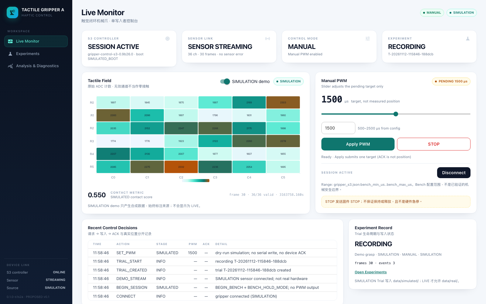

# S1 → S2-A 软件交付报告（触觉闭环机械爪 V1.0）

- 日期：2026-11-12
- 工作目录：`/home/example/Developer/research/tactile-gripper-a-sw`
- 分支：`feat/software-v1`
- S1 基线：`f7d1b1f`（`feat(sensor): establish protocol models and adapters`）
- S2-A 提交：`feat(ui): establish dashboard and experiment skeleton`（本报告随该提交入库）
- 上游基线：`dec50b1` / tag `s0-baseline`
- 约束：本轮未打开真实串口、未烧录固件、未执行 PWM 运动、未连接真实传感器。所有截图与测试数据均为 `SIMULATION` / 离线数据。

## 1. 结论摘要

S1 与 S2-A 的可运行基础已完成：

- 公共协议文档补充了传感器 `HELLO/SAMPLE/STATUS/ERROR` 草案、通道配置、帧序号/重启/时间戳规则、错误处理和版本兼容建议；状态仍为 `PROPOSED v0.1`，没有改成 APPROVED，也没有合入 `main`。
- 数据模型与解析器支持**动态通道数量**（测试覆盖 1/4/12/36），不硬编码 12/16/36；无效通道保留 `valid_mask`/`None`，不按零接触解释。
- Sensor/Gripper Adapter 复用现有 S3 Bench 协议与 `gripper_a` 串口栈；Gripper 只有一个串口写入路径，并有单写者租约。
- Application Core 统一管理 `MANUAL / AUTO / STANDBY / FAULT`、控制仲裁、Trial 生命周期与快照；AUTO 明确不可启用。
- NiceGUI Dashboard 三页可启动：Live Monitor、Experiments、Analysis & Diagnostics。
- Trial 可创建、开始、停止、添加事件、保存 JSONL、导出 CSV、读取与只读回放；来源目录严格隔离。
- 离线测试 200 个通过，1 个 PTY 测试因当前沙箱无 PTY 而跳过；现有 S3/PWM Console 测试全部通过。
- 真实设备、真实传感器、AUTO 闭环、真实 STOP 行为均 **NOT_TESTED**。

## 2. Worktree、分支与提交

| 项目 | 值 |
|---|---|
| 主仓库 | `/home/example/Developer/research/tactile-gripper-a`（`main`，clean） |
| 软件 Worktree | `/home/example/Developer/research/tactile-gripper-a-sw`（`feat/software-v1`） |
| 硬件 Worktree | `/home/example/Developer/research/tactile-gripper-a-hw`（`feat/hardware-acquisition`，clean，未修改） |
| S1 commit | `f7d1b1f feat(sensor): establish protocol models and adapters` |
| S2-A commit | `feat(ui): establish dashboard and experiment skeleton`（当前 HEAD） |

核对结果：

- `git worktree list` 显示三个 worktree 均从 `dec50b1` 派生；软件分支领先 2 个提交。
- 主目录和硬件 worktree 的 `git status` 为空，本轮未修改硬件组目录。
- 未 push、未合并到 `main`、未 rebase/force-push。

## 3. 项目目录结构（本轮新增部分）

```text
src/
  gripper_a/                     # 既有 PWM/串口栈（仅做可注入 fake transport 的最小扩展）
    serial_client.py
    gripper_controller.py
    bench.py
  tactile_gripper/               # S1/S2-A 新包
    constants.py                 # 版本、线长、固件命令映射
    errors.py                    # 稳定错误码
    sources.py                   # LIVE/REPLAY/SIMULATION 与目录映射
    models.py                    # ChannelConfig/TactileFrame/DeviceStatus/Control*/Trial*
    protocol.py                  # HELLO/SAMPLE/STATUS/ERROR 解析、编码、FrameTracker
    paths.py
    devices/
      sensor.py                  # SensorAdapter、Replay、Simulated、JSONL transport
      gripper.py                 # GripperAdapter、WriteAuthority（复用 BenchController）
    control/
      core.py                    # ApplicationCore、Mode、build_core
    experiments/
      store.py                   # TrialStore/TrialRecorder、JSONL、CSV
    ui/
      theme.py                   # 统一视觉、导航、状态 pill
      charts.py                  # ECharts 热图/柱状/趋势
      pages/live.py              # Live Monitor
      pages/experiments.py       # Experiments
      pages/analysis.py          # Analysis & Diagnostics
      server.py                  # 唯一 Core 构建、页面注册、ticker、CLI
config/
  sensor_channels.demo.json      # 36 通道合成演示配置；明确标 SIMULATION_DEMO，不是硬件映射
docs/
  INTERFACE_CONTRACT.md          # 更新（仍 PROPOSED v0.1）
  screenshots/                   # 三页运行截图（demo 模式，SIMULATION）
tests/
  support.py                     # FakeLineTransport / FakeBenchTransport 等离线夹具
  test_models.py                 # 数据模型/校验
  test_protocol.py               # 解析、帧跟踪
  test_sensor_adapter.py         # LIVE/REPLAY/SIMULATION 传感器
  test_gripper_adapter.py        # S3 协议、ACK、拒绝、超时、单写者
  test_core.py                   # 模式、仲裁、来源隔离、Trial
  test_trials.py                 # JSONL/元数据/CSV/路径隔离
  test_dashboard.py              # 启动/页面可访问/UI 不创建 Adapter
```

## 4. 新增与修改文件

### 4.1 S1 提交

新增：

- `src/tactile_gripper/{__init__,constants,errors,sources,models,protocol}.py`
- `src/tactile_gripper/devices/{__init__,sensor,gripper}.py`
- `config/sensor_channels.demo.json`
- `tests/{support,test_models,test_protocol,test_sensor_adapter,test_gripper_adapter}.py`
- `docs/INTERFACE_CONTRACT.md` 的 S1 提案更新

修改：

- `src/gripper_a/gripper_controller.py`：增加可选 `transport` 注入，仅用于离线 fake 串口与显式已持有串口；未改变默认 Console 行为。
- `tests/test_trial_interactive_input.py`：当前沙箱无 PTY 时显式 `skipTest`，避免把环境限制误报为代码失败。

### 4.2 S2-A 提交

新增：

- `src/tactile_gripper/paths.py`
- `src/tactile_gripper/control/{__init__,core}.py`
- `src/tactile_gripper/experiments/{__init__,store}.py`
- `src/tactile_gripper/ui/{__init__,__main__,theme,charts,server}.py`
- `src/tactile_gripper/ui/pages/{__init__,live,experiments,analysis}.py`
- `tests/{test_core,test_trials,test_dashboard}.py`
- `docs/screenshots/{live-monitor,experiments,analysis}.png`
- 本报告

修改：

- `pyproject.toml` / `uv.lock`：加入 `nicegui==4.0.0`，Python 基线提升为 `>=3.11`（NiceGUI 4 要求）。
- `src/tactile_gripper/models.py`：`TactileFrame.to_dict()` 增加 `channel_count`/`valid_count`，供保存帧与 Chart 使用。
- `src/tactile_gripper/devices/sensor.py`：记录 `last_anomalies`，让 Core 把丢帧/重启/时间异常写入事件。
- `src/tactile_gripper/devices/gripper.py`：poll 后同步 session 状态，避免会话到期后仍显示 ACTIVE。

## 5. 复用的现有 PWM 控制代码

没有复制第二套串口控制逻辑。`tactile_gripper.devices.GripperAdapter` 内部持有并调用既有：

- `src/gripper_a/bench.py::BenchController`
  - `connect()` → `GET_STATUS`（不隐含 ARM）
  - `begin(assembled=True)` → `BEGIN_BENCH physical_condition=GRIPPER_ASSEMBLED`
  - `select_mode(True)` → `BENCH_HOLD_MODE`
  - `pulse(value)` → `BENCH_HOLD`
  - `stop()` → `STOP`
  - `heartbeat()/poll()` → `HEARTBEAT`
- `src/gripper_a/gripper_controller.py::GripperController`
- `src/gripper_a/serial_client.py::SerialClient`（真实模式唯一串口 transport）

软件抽象与固件命令的映射记录在 `constants.py::FIRMWARE_COMMAND_MAP` 与 `docs/INTERFACE_CONTRACT.md`：

| 软件动作 | 固件命令 |
|---|---|
| `QUERY_STATUS` | `GET_STATUS` |
| `BEGIN_SESSION` | `BEGIN_BENCH` + `BENCH_HOLD_MODE` |
| `SET_PWM` | `BENCH_HOLD` |
| `STOP` | `STOP` |
| `DISARM` | `DISARM` |
| `HEARTBEAT` | `HEARTBEAT` |
| `STOP_UPDATES` | 无（纯主机） |
| `HOLD` / `RELEASE` | 无已验证命令，显式 UNSUPPORTED |

**语义边界**：`ControlEvent` 分开记录 `serial_write_ok`、`device_ack`，`actual_pwm_us` 始终为 `null`，`actual_position_known=false`。ACK 不被当作位置反馈。

## 6. 公共协议提案的变化

`docs/INTERFACE_CONTRACT.md` 仍为 **PROPOSED v0.1**。新增内容：

1. 明确区分 FACT / SW-PROPOSAL / PENDING-HW。
2. `HELLO`：设备标识、boot_id、固件版本、采样率、通道配置。
3. `SAMPLE`：动态 `channels`、`valid_mask`、可选 `channel_ids`、`contact_score`。
4. `STATUS`：设备自述状态；主机状态独立判定。
5. `ERROR`：`code`、`message`、`request_id`、`fatal`。
6. `channel_config`：`channel_id`、`adc_input`、`ads1220_id`、`mux_channel`、`matrix_row/col`、`unit`、`enabled`；扫描通道数不要求等于矩阵单元数。
7. 主机规则：非法 JSON/超长/缺字段/版本不符/长度不匹配/无效通道/NaN/重复帧/序号回退/丢帧/重启/时间戳异常/主机时钟回退；无效数据与设备离线分开。
8. 版本兼容规则：主版本 integer，语义/单位/时间基准变化必须升主版本。
9. 数据来源隔离：LIVE/REPLAY/SIMULATION 的控制权限与目录。
10. 新增待确认项 C-13..C-18。

没有将协议状态改为 APPROVED；没有把软件提议描述为硬件已实现。

## 7. Dashboard 启动命令与页面

### 7.1 安装/启动

```bash
cd /home/example/Developer/research/tactile-gripper-a-sw
UV_CACHE_DIR=/tmp/uv-cache uv sync --locked   # 沙箱内 uv 缓存需可写目录；普通环境可直接 uv sync

# 离线模式：S3 OFFLINE，SENSOR WAITING，Apply/STOP 禁用
PYTHONPATH=src .venv/bin/python -m tactile_gripper.ui --no-browser --port 8080

# 明确标注的 SIMULATION 演示（合成传感器 + dry-run 控制器 + demo Trial）
PYTHONPATH=src .venv/bin/python -m tactile_gripper.ui --no-browser --demo --port 8080
```

真实设备（本轮未执行，仅保留入口）：

```bash
PYTHONPATH=src .venv/bin/python -m tactile_gripper.ui \
  --source LIVE --hardware-permission \
  --connect-port /dev/cu.usbserial-XXXX --connect --port 8080
```

REPLAY：

```bash
PYTHONPATH=src .venv/bin/python -m tactile_gripper.ui \
  --source REPLAY --sensor-file data/simulated/trials/<TRIAL>/frames.jsonl --port 8080
```

### 7.2 页面

| 路由 | 页面 | 内容 |
|---|---|---|
| `/` | Live Monitor | S3 状态、传感器状态、模式、PWM 目标、滑块/数字输入、Apply、STOP、触觉热图/柱图、接触指标、最近控制决策、Trial 状态 |
| `/experiments` | Experiments | 创建 Trial、实验条件、开始/停止记录、添加事件、JSONL/元数据、CSV 导出、历史列表 |
| `/analysis` | Analysis & Diagnostics | 历史列表、元数据/参数、帧检查、通道趋势、控制事件、异常、只读回放 |

界面要点：

- 无真实设备时 S3 显示 `OFFLINE`；无真实传感器时显示 `SENSOR WAITING`，不伪造波形。
- `--demo` 时所有数据标 `SIMULATION`；接触指标标 `SIMULATED contact score`。
- 滑块只修改待提交值；点击 Apply 才调用 `ApplicationCore.request_pwm()`。
- Apply/STOP 通过统一 Core 与唯一 GripperAdapter；页面不创建串口或 Adapter。
- Analysis 页面没有 Apply/STOP 入口，代码级测试禁止其出现 `request_pwm`、`core.stop(`、`GripperAdapter`。
- STOP 明确提示：发送固件 STOP，不保证保持/释放，且不是硬件急停。

截图（`docs/screenshots/`，由 headless Chrome 对本地 demo 实例截取）：




截图中的 “Demo grasp · SIMULATION” 是合成数据，不是真实实验。

## 8. Trial 数据保存位置与格式

目录由来源强制决定，调用者不能任意指定：

| 来源 | 目录 | 是否允许创建 |
|---|---|---|
| `SIMULATION` | `data/simulated/trials/<TRIAL_ID>/` | 是 |
| `LIVE` | `data/real/trials/<TRIAL_ID>/` | 是（仍需真实硬件授权） |
| `REPLAY` | 无 | 否，`PermissionError` |

每个 Trial 目录：

```text
metadata.json     # TrialMetadata：id/name/source/mode/时间/条件/参数快照/计数/文件索引
events.jsonl      # record_type=CONTROL_EVENT 或 TRIAL_EVENT
frames.jsonl      # record_type=SENSOR_FRAME + 动态通道/valid_mask/source/时间
frames.csv        # 基础列 + ch_<id>/valid_<id> 动态列
```

关键字段：

- `TrialMetadata`：`trial_id`、`name`、`source`、`mode`、`created_at`、`started_at`、`ended_at`、`status`、`conditions`、`parameters`、`software_version`、`protocol_version`、`files`、`counts`。
- `SENSOR_FRAME`：`frame_seq`、`boot_id`、`mcu_time_us`、`host_received_ns`、`host_received_utc`、`source`、`channels`、`valid_mask`、`channel_count`、`valid_count`、`contact_score`。
- `CONTROL_EVENT`：`action`、`stage`、`commanded_pwm_us`、`serial_write_ok`、`device_ack`、`actual_pwm_us=null`、`actual_position_known=false`、`detail`、`response`。

Source mixing 在 `TrialRecorder.record_frame/record_control` 处被拒绝；模拟数据不会写入 `data/real/`。`data/`、`logs/` 均在 `.gitignore` 中，本轮未提交任何实验数据。

## 9. 测试命令、数量与结果

命令：

```bash
cd /home/example/Developer/research/tactile-gripper-a-sw
PYTHONPATH=src .venv/bin/python -m unittest discover -s tests -v
```

结果：

```text
Ran 200 tests in 8.5s
OK (skipped=1)
```

唯一 skip 是 `test_trial_interactive_input.test_pty_waits_for_explicit_input`：当前 DSH 沙箱报 `OSError: out of pty devices`，测试已显式 skip 并注明原因；不是产品代码失败。

测试覆盖：

| 测试文件 | 数量 | 覆盖 |
|---|---:|---|
| `test_models.py` | 20 | 动态通道、长度/NaN/无效通道、协议版本、ACK≠位置、Trial 元数据 |
| `test_protocol.py` | 19 | JSONL 严格解析、HELLO/SAMPLE、重复键/超长、丢帧/重复/回退/重启/时间戳 |
| `test_sensor_adapter.py` | 10 | HELLO→SAMPLE、动态配置、无效数据 vs 离线、STALE、REPLAY 只读、SIMULATION 标注 |
| `test_gripper_adapter.py` | 13 | FakeBenchTransport 协议、GET_STATUS/BEGIN/BENCH_HOLD/STOP、范围拒绝、设备 ERROR、超时、单写者、HOLD/RELEASE UNSUPPORTED |
| `test_core.py` | 16 | 模式切换、AUTO 不可用、单命令仲裁、来源隔离、FAULT 锁存、REPLAY 拒绝控制、Trial |
| `test_trials.py` | 10 | JSONL/元数据/CSV、动态列、路径隔离、REPLAY 禁止录制、坏行报告 |
| `test_dashboard.py` | 5 | HTTP 启动、三页 200、demo 启动、UI 不创建 Adapter、Analysis 无控制路径 |
| 既有 S0/S3 测试 | 107 | 原 PWM Console、S3 配置、串口客户端、Bench/Trial、校准等未回归 |

现有 107 个测试中 106 个直接通过，1 个 PTY 测试 skip；没有修改 S3 固件或 PWM Console 行为。

## 10. 未经过真实硬件验证的功能（NOT_TESTED）

- 真实 S3 串口连接、`BEGIN_BENCH`、`BENCH_HOLD`、`STOP` 的实机时序与响应：**NOT_TESTED**。
- 真实传感器 transport、扫描方式、通道映射、采样率、ADS1220 连接：**NOT_TESTED**；当前只有离线解析器与合成/回放数据。
- 实际 PWM 输出、机械爪开合、位置/开度、保持、释放、停止延迟：**NOT_TESTED**。
- AUTO 闭环：**未实现**，UI/接口显示不可启用。
- 真实 STOP 的保持/掉落行为、硬件急停、断线恢复：**UNKNOWN / NOT_TESTED**。
- Dashboard 在真实 Mac 浏览器长期运行/投屏：仅用 headless Chrome 对本地实例完成截图与 HTTP 可访问性检查。

## 11. 待硬件组确认的接口问题

以下均保持 PENDING-HW，未用猜测值实现：

1. C-01 通道数量、6×6 矩阵与物理位置映射。
2. C-02 6×6 扫描/复用方式。
3. C-03 三颗 ADS1220 的总线、片选/地址、通道分配。
4. C-04 采样率、整帧周期、抖动、同步精度、丢帧定义。
5. C-05 通道有效性与部分有效帧策略。
6. C-06 帧序号起点/回绕/重启行为、`boot_id` 是否变化（C-18）。
7. C-07 MCU 时间戳单位/原点/是否含睡眠。
8. C-08 错误码、CRC/校验、重试策略。
9. C-09 版本兼容与弃用策略。
10. C-10 传输介质、波特率、编码、消息边界（软件建议 JSONL）。
11. C-11 原始数值的物理单位、基线、标定。
12. C-12 控制命令与状态语义、ACK/到位区别、STOP/FAULT 安全联动。
13. C-13 `HELLO.channel_config` 是否由设备提供。
14. C-14 无效通道的线值（null 或占位数字）。
15. C-15 `contact_score` 是否提供及其算法。
16. C-16 传感器与 S3 是否同一 MCU/同一串口。
17. C-17 传感器侧独立心跳/超时策略。

## 12. 下一阶段建议

1. 硬件组确认 C-01..C-18 后，冻结 `HELLO`/`SAMPLE` 字段与 `channel_config`；在此之前保持 PROPOSED。
2. 实现真实 Sensor Serial Transport（仅解析、不自动触发运动），先在离线回放与真实只读采样中验证。
3. 在真实 S3 上做**只读** `GET_STATUS` 联调，再经单独授权验证 `BEGIN_BENCH` 与单次 `BENCH_HOLD`；核对 ACK、超时、STOP 的实际效果。
4. 完成 6×6 映射的方向/单元对照后，再启用接触指标与 AUTO 状态；AUTO 算法与阈值必须来自标定数据。
5. 增加真实 Trial 的视频关联、失败/中断记录与数据完整性检查；仍保持 `data/real` 与模拟目录分离。
6. 后续如引入真实传感器串口，仍坚持“一个 Core、一个 Gripper Adapter、一个写入者”，并在 CI/离线测试中继续禁止真实端口访问。

## 13. 已知限制与说明

- `nicegui==4.0.0` 要求 Python >= 3.11，因此项目 `requires-python` 从 `>=3.9` 提升为 `>=3.11`；uv 环境使用 Python 3.13.15。
- Demo 模式会写入 `data/simulated/trials/`（gitignored）；不是实验数据，截图已明确标注 SIMULATION。
- 仿真配置 `config/sensor_channels.demo.json` 只是 36 通道显示/解析演示，`status=SIMULATION_DEMO`，不代表 H1 已确认的矩阵扫描或 ADC 映射。
- `GripperAdapter` 的 PWM 范围来自 `config/gripper_s3.json` 的 `bench_min_us..bench_max_us`（500–2500 μs），是 Bench 配置范围，**不是**机械安全边界；`safe_min_us/safe_max_us` 仍为 `null`。
- 本轮未修改 `main`、未修改硬件 worktree、未 push、未合并、未打开真实串口。
