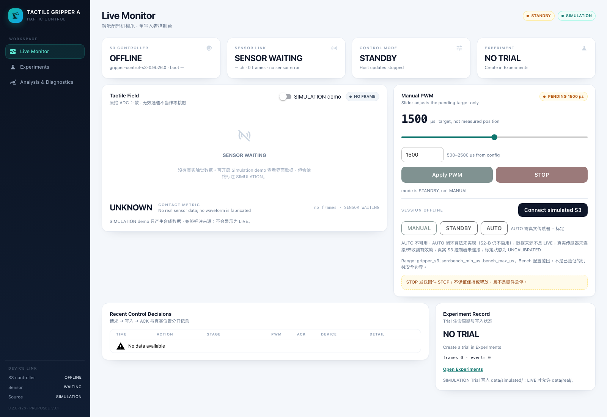
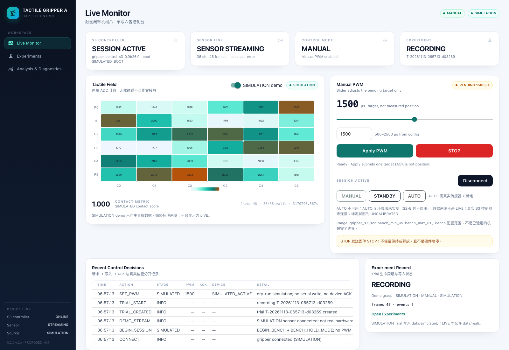

# S2-B 软件交付报告：控制链路、Trial 可靠性与 Dashboard V1.0

- 日期：2026-11-13
- 工作目录：`/home/example/Developer/research/tactile-gripper-a-sw`
- 分支：`feat/software-v1`
- 基线：`acd38f6`（S1/S2-A 验收后）
- S2-B 提交：`feat(s2b): harden control, trial recovery and dashboard feedback`（HEAD）
- 约束：未打开真实串口、未连接真实 ESP32/传感器、未发送 PWM、未烧录固件。截图与测试数据全部为 `SIMULATION`。

## 1. 结论摘要

S2-B 完成了控制链路核查与缺陷修复、Trial 中断/写失败可靠性、Dashboard V1.0 反馈和协议协作准备。

关键结论：

- 默认启动不会创建 `BenchController`、不会打开串口、不会发送 `GET_STATUS` 之外的任何命令；未连接时界面显示 `S3 OFFLINE / SENSOR WAITING`。
- 只有 `source=LIVE + hardware_permission=True` 才能构造真实 `GripperAdapter`；CLI 还要求显式 `--connect-port`。
- 查询状态（`GET_STATUS`）与建立手动会话（`BEGIN_BENCH` + `BENCH_HOLD_MODE`）是两个独立操作；UI 的 Connect 与 Begin manual session 也已分开。
- `BEGIN_BENCH` → `BENCH_HOLD_MODE` → `BENCH_HOLD` 顺序由测试固定；`BEGIN_BENCH` 不输出 PWM。
- 同一进程只有一个 `WriteAuthority` 持有者；第二个 Adapter 连接会被拒绝。
- AUTO 仍不可启用；`set_mode(AUTO)` 在发送任何命令前失败。
- REPLAY/SIMULATION 在 Core、GripperAdapter、传感器 transport、Analysis 页面多层禁止硬件写入。
- STOP 的实际固件语义已按 `SafetyCore.h` 源码确认；真实机械停止/保持/掉落仍 **NOT_TESTED**。

离线测试：**219 passed, 1 skipped**。skip 仍为沙箱无 PTY，不是产品代码失败。

## 2. 控制链路逐项核查

| 核查项 | 结论 | 证据/测试 |
|---|---|---|
| 默认启动不连接/不发送 PWM | 通过。`build_core(SIMULATION)` 的 `gripper.controller is None`；默认 UI 无传感器/无会话 | `test_build_simulation`、`test_live_core_without_connect_opens_no_controller`、`live-offline.png` |
| 只有明确 LIVE 才能创建真实串口 | 通过。LIVE 构造要求 `hardware_permission=True`；CLI 要求 `--hardware-permission` + `--connect-port`；未授权抛 `ControlDenied` | `test_live_requires_explicit_permission`、`test_live_without_permission_is_refused` |
| 查询状态与建立会话分离 | 通过。connect → `GET_STATUS`；begin → `BEGIN_BENCH` + `BENCH_HOLD_MODE`；UI 分两次点击 | `test_connect_queries_status_without_pwm`、`test_command_order_begin_before_pwm` |
| `BEGIN_BENCH` / `BENCH_HOLD_MODE` / `BENCH_HOLD` 时序 | 通过。测试断言顺序且 `BEGIN_BENCH` 后没有 PWM；第一次 `BENCH_HOLD` 才设置输出 | `test_command_order_begin_before_pwm` |
| Dashboard 不创建第二个串口写入者 | 通过。页面不 import/构造 `GripperAdapter`；Core 是唯一 Adapter 持有者；`WriteAuthority` 拒绝第二个连接 | `test_pages_do_not_create_adapters`、`test_single_writer_authority`、`test_single_writer_shared_authority` |
| AUTO 未标定时不发送真实 PWM | 通过。`auto_available()` 固定返回不可用；`set_mode(AUTO)` 抛 `ModeUnavailable`；测试确认命令列表不变 | `test_auto_is_refused_without_any_command` |
| REPLAY/SIMULATION 无法绕过写入限制 | 通过。Core 拒绝 REPLAY 控制；GripperAdapter 拒绝 REPLAY source；SIMULATION 使用 dry-run；Sensor transport 没有写方法；Analysis 无控制调用 | `test_replay_is_read_only`、`test_simulation_never_claims_serial_write_or_ack`、`test_analysis_page_has_no_control_write_path` |
| STOP 固件语义 | 已按源码确认，见下节；机械行为 NOT_TESTED | `test_stop_from_fault_is_ack_but_does_not_clear_fault`、`test_disarm_clears_fault`、`test_stop_output_failure_is_fault` |

### 2.1 STOP / DISARM 源码事实（FACT）

依据 `firmware/gripper_control/SafetyCore.h`：

- `STOP`/`DISARM` 清除 trial/bench/hold/mech 许可，调用 `output.off()`；
- `LedcOutput::off()` 执行 `ledcWrite(GPIO, 0)` + `ledcDetach(GPIO)`；成功才返回 true；
- 一般路径：`output.off()` 成功 → `DISARMED`，失败 → `FAULT` / `outputUnknown`；
- **FAULT 下的 STOP 是特殊路径**：只重试 `output.off()`，成功后仍返回 ACK 但 **state 仍为 FAULT**；
- **FAULT 下的 DISARM**：走通用撤销分支，`output.off()` 成功后 state → `DISARMED`；
- 本轮修复了旧软件把“FAULT 下 STOP 的 ACK”误显示为 `CONNECTED/STANDBY` 的问题。现在 `ControlEvent.firmware_state`、Adapter state、Core mode 都保留 FAULT，UI 提示需重连/授权。
- STOP 不保证机械停止、不保证保持或释放，不是硬件急停；以上均未在真实机构上验证。

## 3. 本轮修复的问题

1. **STOP 后状态错误**：`GripperAdapter` 原先无条件把 STOP/DISARM 后状态设为 `CONNECTED`，即使固件回复 `state=FAULT`。现在从响应同步状态；Core 在 FAULT 下不把 STOP 当正常结束。
2. **模拟 PWM 的固件状态误导**：dry-run 的 `BENCH_HOLD` 原先返回 `ARMED`；现在明确标 `SIMULATED_ACTIVE`，不冒充真实固件 ACTIVE。
3. **Connect 与会话建立混在一次点击**：UI 现在先 Connect（仅查询/连接），再 Begin manual session；符合“查询状态 ≠ 建立控制会话”。
4. **缺少模式切换 UI**：Live Monitor 增加 MANUAL / STANDBY / AUTO（不可用）按钮、FAULT 横幅和 Reset fault；STANDBY 只停止主机更新，不冒充设备停止。
5. **Trial 缺少中断恢复**：新增 `recording.json` 锁（PID/host/heartbeat）；进程消失或锁缺失时，历史 Trial 标 `INTERRUPTED`，保留帧/事件且不标记 COMPLETED。
6. **Trial 写失败会传播**：新增 `TrialWriteError`；帧/事件/锁写失败将 Trial 标 `ERROR`，关闭文件并保留已写数据；Core 进入 FAULT 并阻止继续提交。
7. **Trial 元数据不完整**：新增 `schema_version=2`、`git_commit`、`write_error`、完整 `gripper_config`/`sensor_config` 快照、环境信息与完整性计数。
8. **Analysis 缺少时间关联**：新增 PWM Timeline、命令 ID、ACK/DEVICE 状态、数据完整性摘要、INTERRUPTED/ERROR 提示。
9. **Experiments 缺少中断处理**：新增 Abort trial（ABORTED）、Stop & complete、恢复提示和历史 INTERRUPTED/ERROR 提示。
10. **版本**：软件版本提升为 `0.2.0-s2b`（仍不等同于硬件验证）。

## 4. Trial 数据格式与恢复

### 4.1 目录与文件

| 来源 | 目录 |
|---|---|
| `SIMULATION` | `data/simulated/trials/<TRIAL_ID>/` |
| `LIVE` | `data/real/trials/<TRIAL_ID>/` |
| `REPLAY` | 只读，不创建目录 |

```text
metadata.json      # TrialMetadata，schema_version=2
recording.json     # 录制锁：trial_id/pid/host/heartbeat_utc/heartbeat_ns
events.jsonl       # CONTROL_EVENT / TRIAL_EVENT
frames.jsonl       # SENSOR_FRAME + channel_count/valid_count/valid_mask/source/时间
frames.csv         # 与 S1/S2-A 兼容的动态列：ch_<id>/valid_<id>
```

### 4.2 schema 兼容

- 新 Trial 使用 `schema_version=2`。
- 读取 v1 metadata（无 `schema_version`）时默认 `1`，不要求迁移；CSV 列不变。
- v2 只增加字段/锁文件/计数，不删除 S1/S2-A 字段；旧读取器可忽略未知字段。
- 迁移说明：不需要数据库；旧 Trial 可直接 `TrialStore.load()`；如旧 Trial 状态为 `RECORDING` 且无锁，会被恢复为 `INTERRUPTED`。

### 4.3 完整性统计

`metadata.counts` 与 Analysis 摘要包含：

- `frames`、`events`
- `invalid_channel_samples`、`frames_with_invalid_channels`
- `dropped_frames`、`duplicate_frames`、`restarts`
- CONTROL_EVENT 的 `ack_events`、`failed_control_events`
- `read_errors`、`write_error`、`recording_lock_present`

有效性/丢帧统计从已保存帧重新计算，避免只信任内存计数。

### 4.4 中断与写失败状态

| 状态 | 含义 | 是否正常完成 |
|---|---|---|
| `CREATED` | 已创建未开始 | 否 |
| `RECORDING` | 正在录制 | 否 |
| `COMPLETED` | 操作员正常 Stop | 是 |
| `ABORTED` | 操作员 Abort | 否（完成但标记中断） |
| `INTERRUPTED` | 进程异常结束/锁缺失，恢复时标记 | 否 |
| `ERROR` | 帧/事件/锁写入失败 | 否 |

恢复流程不修改已有 frames/events；只追加 `TRIAL_INTERRUPTED` 事件、设置 `ended_at`、更新 counts、导出 CSV。活动进程的锁（PID 存活且 heartbeat 新鲜）不会误标。

### 4.5 元数据示例

```json
{
  "trial_id": "T-20261113-...",
  "source": "SIMULATION",
  "mode": "MANUAL",
  "schema_version": 2,
  "git_commit": "<40-char hash>",
  "parameters": {
    "software_version": "0.2.0-s2b",
    "firmware_version": "gripper-control-s3-0.9b26.0",
    "pwm_limits": {"min_us": 500, "max_us": 2500, "note": "...NOT a verified mechanical safety limit"},
    "gripper_config": {"...": "full config snapshot"},
    "sensor_config": {"...": "channel_config or null"},
    "environment": {"python": "3.13.15", "platform": "macOS-...", "git_commit": "..."}
  },
  "counts": {"frames": 0, "events": 2, "invalid_channel_samples": 0, "dropped_frames": 0}
}
```

## 5. Dashboard V1.0

### 5.1 启动

```bash
cd /home/example/Developer/research/tactile-gripper-a-sw
PYTHONPATH=src .venv/bin/python -m tactile_gripper.ui --no-browser --port 8080
# 明确 SIMULATION demo：
PYTHONPATH=src .venv/bin/python -m tactile_gripper.ui --no-browser --demo --port 8080
```

LIVE 入口（本轮未执行）：

```bash
PYTHONPATH=src .venv/bin/python -m tactile_gripper.ui \
  --source LIVE --hardware-permission --connect-port /dev/cu.usbserial-XXXX --connect
```

### 5.2 页面能力

- **Live Monitor**：S3/传感器/模式/Trial 指标；手动 PWM 滑块/输入；Apply；高可见性红色 STOP；MANUAL/STANDBY/AUTO（禁用）；FAULT 横幅与 Reset；控制决策表显示 `STAGE/ACK/DEVICE`；无真实数据显示 `SENSOR WAITING`。
- **Experiments**：创建 Trial、条件/参数、Start、Stop & complete、Abort trial、事件标记、CSV、历史列表、RECORDING/INTERRUPTED/ERROR 提示。
- **Analysis**：历史查询、帧检查、动态通道趋势、PWM Timeline、控制事件与命令 ID、ACK/DEVICE、异常、完整性计数、只读回放；无 Apply/STOP。

### 5.3 截图

实际运行截图（demo 为 SIMULATION；第一张为无硬件离线启动）：





## 6. 测试

```bash
PYTHONPATH=src .venv/bin/python -m unittest discover -s tests -v
```

```text
Ran 219 tests in 9.4s
OK (skipped=1)
```

- 基线 200 项全部保留通过。
- 新增 19 项，覆盖：默认启动零命令、LIVE 未授权拒绝、命令顺序、STOP/FAULT/DISARM 差异、输出关闭失败、AUTO 零命令、Trial 中断恢复、活动锁不误标、缺失锁恢复、帧写失败保留旧数据、完整性计数、schema/git 元数据、PWM Timeline、Dashboard 页面与只读检查。
- 1 个 skip：沙箱 `out of pty devices`（既有测试，已注明）。

## 7. 公共协议协作

- 共享契约仍为 **PROPOSED v0.1**，未变 APPROVED、未合入 main。
- `docs/INTERFACE_CONTRACT.md` 增加 STOP/DISARM 源码事实与 S2-B 变更记录。
- 新增 `docs/PROTOCOL_COLLABORATION.md`，整理最小 HELLO/SAMPLE 字段、ADC 输入/扫描通道/感测单元区别、无效通道规则、序列/时间/采样率要求、版本兼容与 C-01..C-18 问题清单。
- 硬件组仍拥有独立 Worktree；未修改其固件或文件。

## 8. 真实硬件 NOT_TESTED

- 真实 S3 串口连接、`BEGIN_BENCH`、`BENCH_HOLD_MODE`、`BENCH_HOLD`、STOP/DISARM 时序与延迟。
- 真实传感器 transport、6×6 扫描、ADS1220 映射、采样率。
- 实际 PWM、机械位置/开度、保持、释放、掉落、停止延迟。
- 真实键盘/鼠标 Dashboard 长期运行与投屏；截图由 headless Chrome 对本地实例完成。
- AUTO 闭环（未实现，界面/接口保持不可用）。

## 9. 下一阶段建议

1. 硬件组评审 `PROTOCOL_COLLABORATION.md` 与 C-01..C-18，冻结最小 HELLO/SAMPLE。
2. 实现真实 Sensor 只读 transport，先做只读采样/回放核对（不触发运动）。
3. 经单独授权，在真实 S3 上做只读状态联调；再验证一次 `BEGIN_BENCH` 与单次 `BENCH_HOLD`，核对 ACK、FAULT、STOP、DISARM 差异。
4. 完成矩阵映射/标定后，才讨论接触指标与 AUTO；AUTO 必须仍受真实传感器、标定与授权三重门槛。
5. 增加真实 Trial 的视频关联、失败/中断记录和文件校验；继续保持 `data/real` 与 `data/simulated` 隔离。

## 10. 变更文件（摘要）

- 控制：`devices/gripper.py`、`control/core.py`、`models.py`、`errors.py`、`constants.py`
- Trial：`experiments/store.py`、`paths.py`
- UI：`ui/charts.py`、`ui/pages/{live,experiments,analysis}.py`、`ui/theme.py`、`ui/server.py`
- 文档：`docs/INTERFACE_CONTRACT.md`、`docs/PROTOCOL_COLLABORATION.md`、本报告、截图
- 测试：`tests/{support,test_core,test_gripper_adapter,test_trials,test_dashboard}.py`
- 未修改：`firmware/`、`src/gripper_a/` 既有控制实现、硬件组 Worktree、`main`
